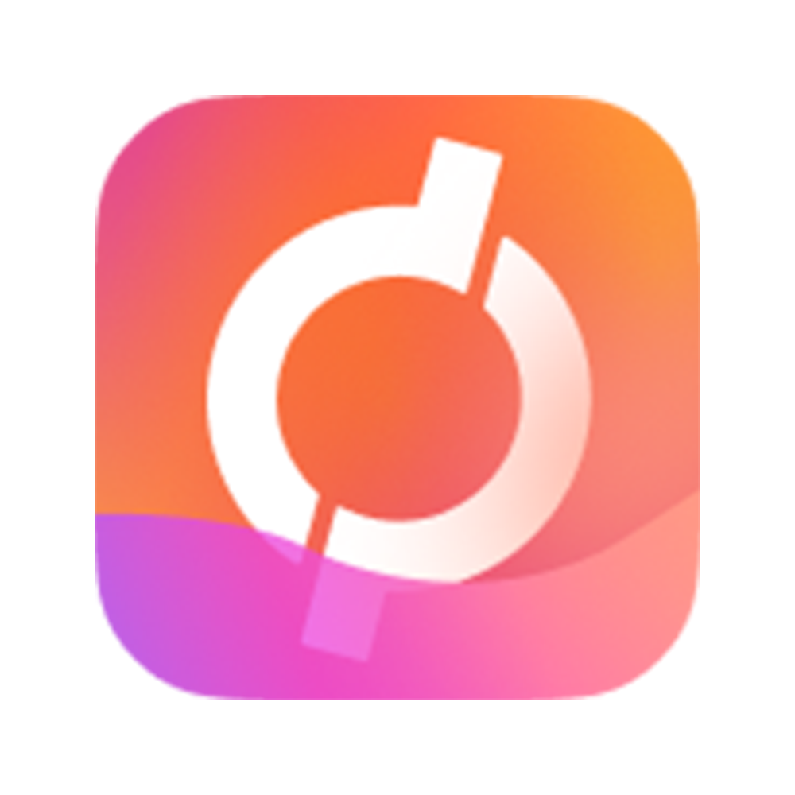

# FOS Documentation

Professional documentation site for the FOS blockchain platform, built with [Fumadocs](https://fumadocs.vercel.app/) and Next.js 16.



## Current project specification

User-facing FOS contracts are specified on **Robinhood Chain** (mainnet 4663; testnet 46630). **Base** remains the Chainlink VRF service side, with the specified **CCIP** request/response flow. Referrals now use $2/$5/$10 plans with 50%/60%/82% direct-referrer shares and price-difference upgrades. See the current MDX contract references; this repository does not contain Solidity deployments.

The revised PDF has editable LaTeX in `whitepaper/whitepaper.tex` and a downloadable copy in `public/whitepaper.tex`. See [whitepaper build instructions](whitepaper/README.md).

## ✨ Features

- 📚 **15+ Documentation Pages** - Whitepaper, Smart Contracts, API, Platform guides
- 🤖 **AI Assistant** - Powered by Google Gemini 2.5 Flash
- 🔍 **Full-text Search** - Built-in Orama search
- 🎨 **Custom Branding** - Gradient theme matching FOS logo
- 📱 **Fully Responsive** - Mobile-optimized with full-screen chat
- 🌙 **Dark Mode** - Beautiful dark theme by default

---

## 🚀 Quick Start

### Prerequisites

- **Node.js** 20.9 or higher (Node.js 24 verified in the cloud environment)
- **npm** 9.x or higher (comes with Node.js)
- **Git** (for cloning)

### 1. Clone the Repository

```bash
git clone https://github.com/alirezaehteshampour/Fos-Doc.git
cd Fos-Doc
```

### 2. Install Dependencies

```bash
npm ci
```

### 3. Configure Environment

The docs and search work without a key. To enable AI chat, set `GEMINI_API_KEY` securely in your cloud deployment environment, or use an ignored local environment file in the cloud checkout:

```bash
cp .env.example .env.local
```

Edit `.env.local` and add your Gemini API key:

```env
GEMINI_API_KEY=your_gemini_api_key_here
```

> 💡 Get a free API key from [Google AI Studio](https://aistudio.google.com/app/apikey)

### 4. Run Development Server

```bash
npm run dev
```

The default deployment path is `/document`. Open the corresponding `/document` path on your development host. For a site served at the domain root, set `NEXT_PUBLIC_BASE_PATH=""` **before building**.

---

## 🏭 Production Deployment

### Option A: Vercel (Recommended)

1. Push to GitHub
2. Import project in [Vercel](https://vercel.com)
3. Add environment variable: `GEMINI_API_KEY`
4. Deploy!

### Option B: Self-Hosted Server

#### Build for Production

```bash
npm run build
```

#### Start Production Server

```bash
npm start
```

The app runs on port **3000** by default, with `/document` as its build-time base path.

#### Using PM2 (Recommended for Production)

```bash
# Install PM2 globally
npm install -g pm2

# Start with PM2
pm2 start npm --name "fos-docs" -- start

# Auto-restart on server reboot
pm2 startup
pm2 save
```

#### Using Docker

```dockerfile
# Dockerfile included in repo
docker build -t fos-docs .
docker run -p 3000:3000 -e GEMINI_API_KEY=your_key fos-docs
```

---

## 📁 Project Structure

```
fos-docs/
├── content/docs/           # MDX documentation files
│   ├── whitepaper/         # Whitepaper docs
│   ├── smart-contracts/    # Smart contract docs
│   ├── platform/           # Platform docs
│   ├── api/                # API reference
│   └── infrastructure/     # Infrastructure docs
├── public/                 # Static assets
│   └── logo.png           # FOS logo
├── src/
│   ├── app/               # Next.js app router
│   │   ├── api/           # API routes (chat, search)
│   │   ├── docs/          # Documentation pages
│   │   └── page.tsx       # Landing page
│   ├── components/        # React components
│   │   └── ai-chat.tsx    # AI chat widget
│   └── lib/               # Utilities
└── .env.local             # Environment variables (create this)
```

---

## ⚙️ Environment Variables

| Variable | Required | Description |
|----------|----------|-------------|
| `GEMINI_API_KEY` | AI chat only | Google Gemini API key; never commit it |

---

## 🔧 Customization

### Changing the Logo

Replace `public/logo.png` with your logo file.

### Updating Theme Colors

Edit the gradient colors in:
- `src/app/page.tsx` (landing page)
- `src/components/ai-chat.tsx` (chat widget)
- `src/lib/layout.shared.tsx` (navigation)

### Adding Documentation

1. Create `.mdx` file in `content/docs/`
2. Add frontmatter:
   ```mdx
   ---
   title: Page Title
   description: Page description
   ---
   
   Your content here...
   ```
3. Update `meta.json` in the parent folder

---

## 📋 Available Scripts

| Command | Description |
|---------|-------------|
| `npm run dev` | Start development server |
| `npm run build` | Build for production |
| `npm start` | Start production server |
| `npm run lint` | Run ESLint |
| `npm run docs:generate` | Refresh AI knowledge, consolidated docs, and LaTeX from current MDX |
| `npm run whitepaper:build` | Generate artifacts and compile the current PDF |
| `npm run docs:check` | Check links, economics, source equality, PDF content, research citations, and AI freshness |
| `npm run deployment:check -- URL` | Validate the running documentation mount, assets, PDF response, and removed-history routes |

---

## 🛠️ Tech Stack

- **Framework**: Next.js 16 (App Router)
- **Documentation**: Fumadocs
- **Styling**: Tailwind CSS 4
- **AI**: Google Gemini 2.5 Flash
- **Search**: Orama
- **Language**: TypeScript

---

## 📄 License

Private - All rights reserved.

---

## 🆘 Support

For issues or questions, contact the FOS development team.

## Documentation maintenance

Follow the original product-language convention in [docs/terminology.md](docs/terminology.md). Current prose uses Fos Digital Collectible, promotional distribution, recipient, allocation, loyalty reward, and cycle. Keep exact contract identifiers and the underlying mechanics accurate. `npm run docs:check` guards against newly introduced restricted vocabulary.

Edit canonical pages under `content/docs`, then run `npm run whitepaper:build`, `npm run docs:check`, `npm run lint`, and `npm run build`. Python 3, Pandoc, XeLaTeX, and DejaVu fonts are required to regenerate the paper and are available in the prepared cloud environment. Node deployments use the committed PDF, LaTeX, and AI reference; they do not need TeX installed. Inter is vendored with its OFL license, so site builds require no Google Fonts download. Prior editions remain in Git history; historical pages and PDF downloads are not included in the site.

All preparation was performed in the cloud checkout. Existing cloud tasks are isolated; use their checkout without creating a Git worktree unless explicitly requested.

The default public mount is `https://fos.ooo/document`. Read the scoped reverse-proxy instructions in [DEPLOY.md](DEPLOY.md) before deploying under the main website; the upstream must retain the `/document` request prefix. Logo artwork is unchanged. The current market research cites pinned sources checked October 20, 2026, with integrity snapshots under `docs/research`.
