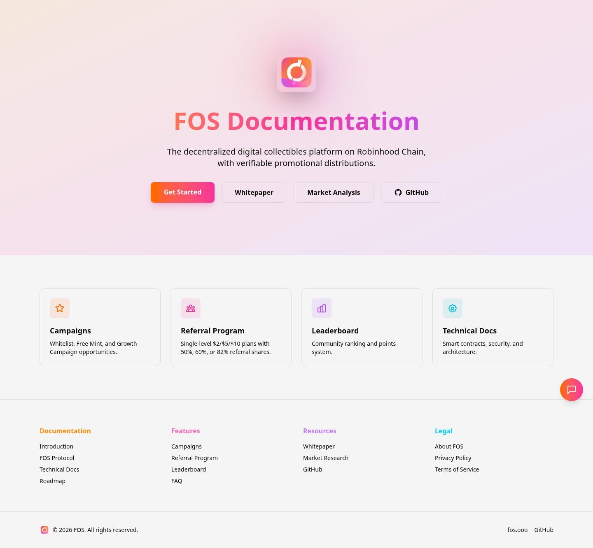
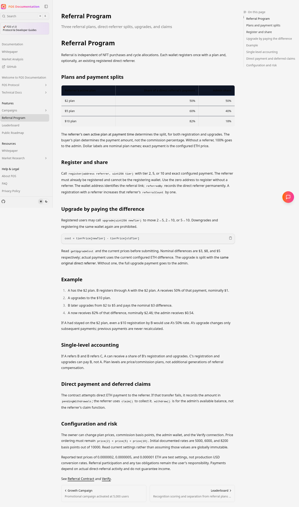
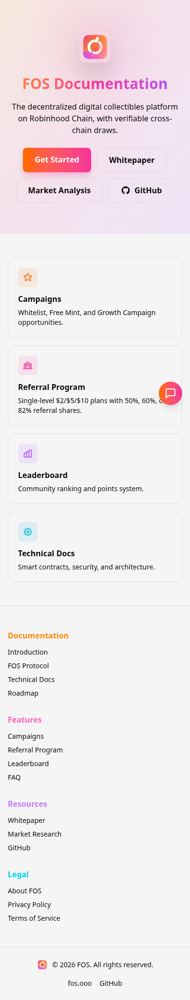
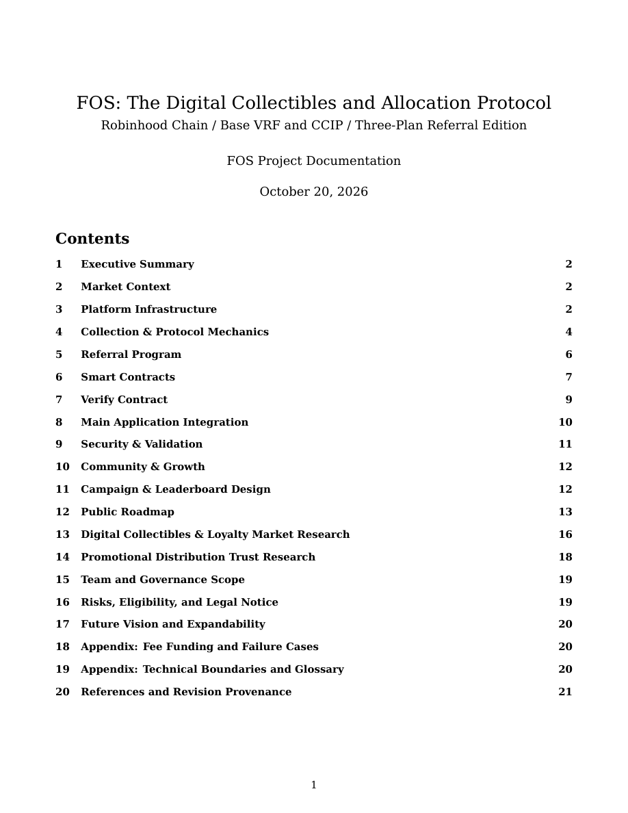
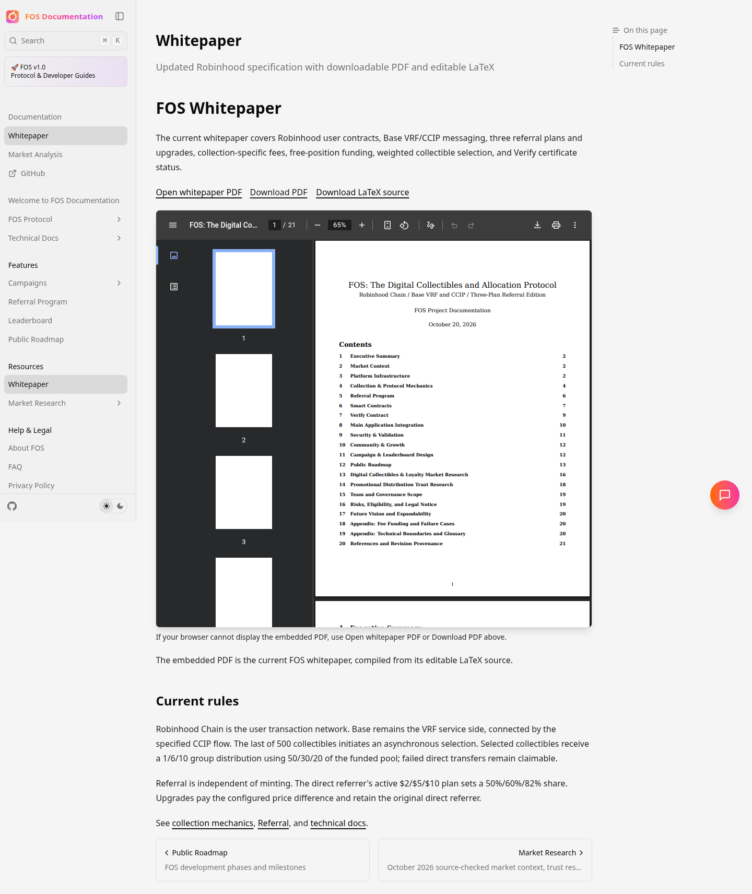
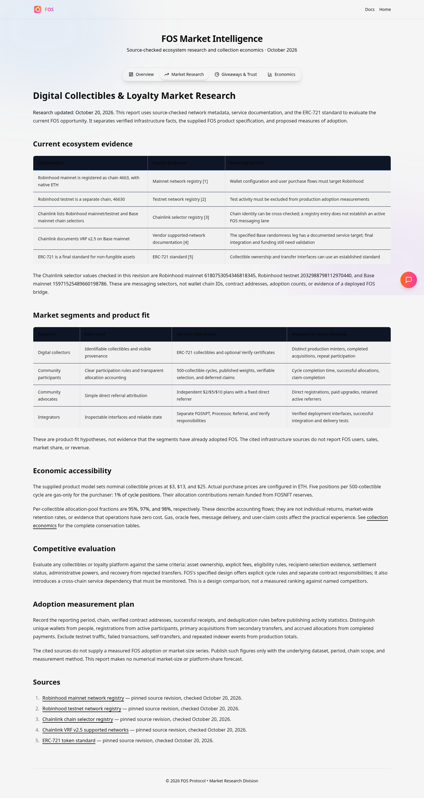

# Review the updated FOS documentation

These are browser captures from the tested cloud production build, refreshed October 20, 2026 for the /document deployment, corrected logo/PDF paths, and current market research. They show the implementation for review; they are not an interactive hosted preview or proof of a completed live deployment.

## Whitepaper downloads

- [Current PDF](https://raw.githubusercontent.com/alirezaehteshampour/Fos-Doc/main/public/whitepaper.pdf)
- [Editable LaTeX](https://raw.githubusercontent.com/alirezaehteshampour/Fos-Doc/main/public/whitepaper.tex)
- [View PDF on GitHub](../../public/whitepaper.pdf)

The PDF and LaTeX are committed alongside the site. GitHub links require the same repository access as the code; an inaccessible repository/file may return 404. The source reproduces the revised PDF byte-for-byte; the unchanged original and embedding-based historical facsimile are described in [whitepaper provenance](../../whitepaper/README.md).

## Verified behavior

Production build, TypeScript, lint, documentation consistency, all 33 current documentation routes plus five application pages, search, chart rendering, FAQ expansion, and whitepaper assets passed checks. Browser checks cover logos, scoped links, the PDF viewer and download, current research, actual search, and mobile layouts under /document. Removed whitepaper and historical documentation URLs return 404 and do not appear in search.

Real AI answers still require `GEMINI_API_KEY` in the hosting environment. Hosting deployment has not been confirmed. No laptop filesystem or local installation was used.

## Desktop homepage

## Referral documentation

## Mobile homepage

## Whitepaper cover and contents

## Whitepaper viewer

## Current market research

